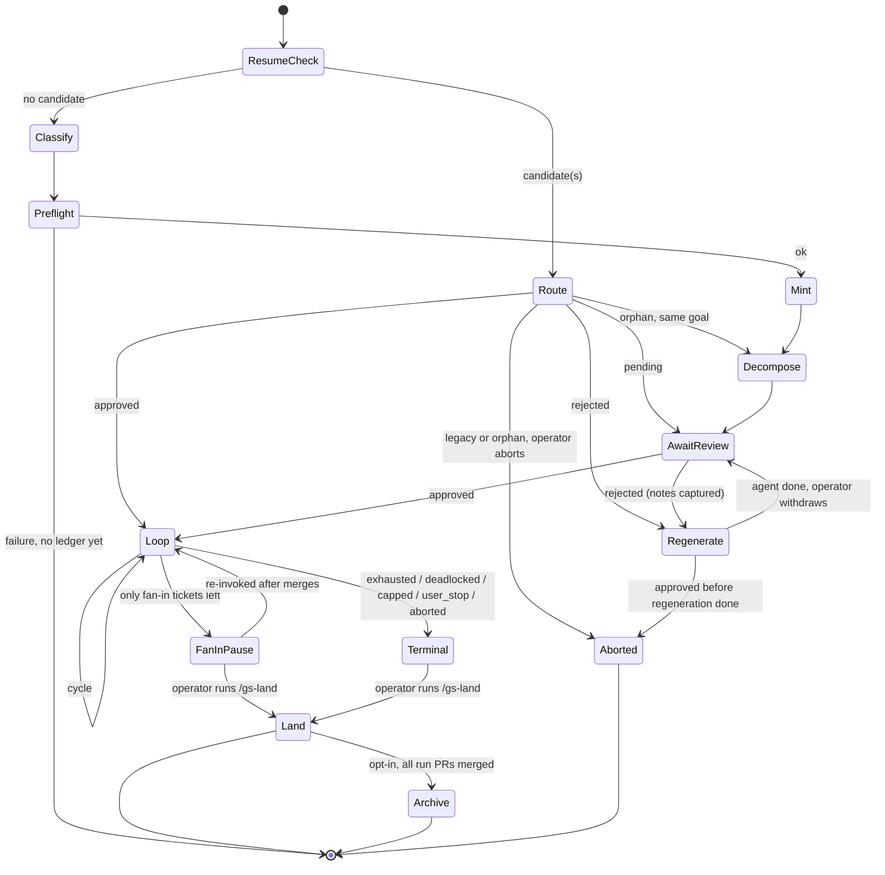
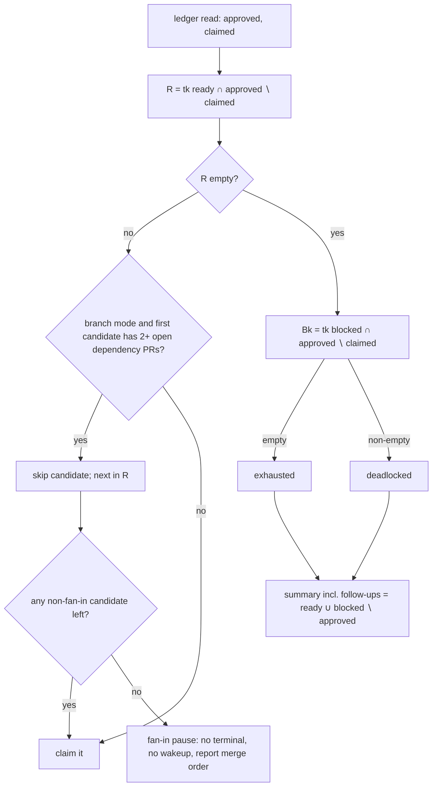
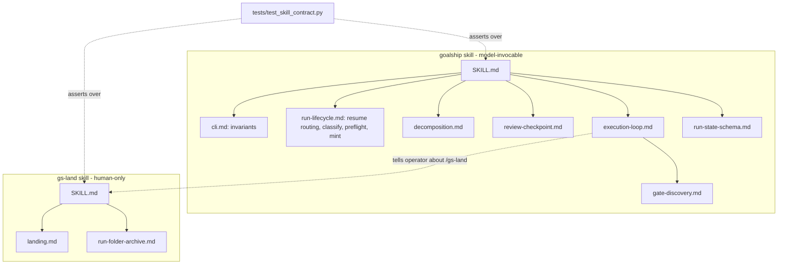

# Goalship CLI Integration and Skill Architecture - Plan

**Target repos:** `agent-extentions` (this repo; all file paths below are relative to it). Companion issues go to `Christophe1997/goalship`; this plan changes no Go code.

## Goal Capsule

- **Objective:** Someone who hands a goal to goalship approves the ticket graph once, in the browser, and then gets per-ticket PRs unattended. Each run's tickets stay separate from every other run's. A finished stack can be landed safely on request. Every fix to the loop mechanics lands in one place.
- **Means:** The skill becomes pure orchestration over the `goalship` binary (KTD1), split into the unattended `goalship` skill and a human-only `gs-land` skill (KTD12).
- **Authority hierarchy:**
  - This plan's Product Contract wins on behavior.
  - Key Technical Decisions win on mechanism.
  - The `goalship` CLI's actual behavior (`goalship <cmd> --help`, its README) wins over any command shape quoted here.
- **Stop conditions:**
  - Stop and ask if a unit would need a change to Go code in `Christophe1997/goalship`. File it as a companion issue instead (U9).
  - Stop and ask if a unit would let the unattended loop merge, approve, force-push, or delete a branch.
  - Stop and ask if a unit would let the agent write the review state or approve a run.
- **Execution profile:** Strict TDD per the user's global instructions. U1's contract test is written red first, and every later unit turns some of its assertions green.
- **Who finishes:** `ce-work` implements and verifies locally. Filing and updating GitHub issues in U9 is outward-facing, so the user confirms each before it is sent. The developer reviews and merges.
- **Open blockers:** None.

---

## Product Contract

### Summary

Move the goalship plugin off its Python scripts and bash `tk`, onto the `goalship` CLI.
Restructure the plugin around the run lifecycle the CLI now enforces:
- create the run first
- decompose into the run's own ticket folder
- wait for browser approval
- run the unattended loop over approved tickets only

Add a separate, human-only skill that lands a run's stacked PRs and can commit the run's ticket folder.
File the CLI-side gaps as companion issues instead of working around them silently.

### Problem Frame

The goalship skill on `main` still drives `plugins/goalship/scripts/loop_runner.py` and the standalone `tk` binary. The `goalship` CLI is a faithful Go port of both, and it has since added capability the skill can't reach:
- a browser review checkpoint that structurally gates `loop claim`
- per-run ticket folders (`.tickets/<run-id>/`)
- stack primitives (`merge-order`, `retarget-pr`, `sweep-branches`)

Two implementations of the same mechanics now drift. Issue #5 showed that the fan-in gap lives identically in both.

Open issues #5–#10 all wait on the same move. Issues #9 and #10 need per-run folders, and #7 needs the stack primitives. #6 and #10 also need someone to own how ticket folders reach git, which the CLI explicitly hands to the skill.

The CLI also changes what the skill must cope with:
- Approval is mandatory, and a rejection leaves the review server running.
- Tickets created after approval can never be claimed.
- A mistyped `--run-id` on `loop ledger` silently mints a new run.
- Nothing in the CLI fetches trunk.

A straight find-and-replace of `loop_runner.py` would produce a loop that falsely reports itself exhausted or deadlocked, consumes unapproved tickets as claims, and cuts branches from stale trunk.

### Actors

- A1. Operator: the human who invokes goalship, approves or rejects the graph in the browser, and invokes landing.
- A2. Orchestrating agent: the session running the `goalship` skill (and, when A1 invokes it, `gs-land`).
- A3. `goalship` CLI: the mechanics layer. It owns the ledger, ticket files, review server, and every git/host operation except the exceptions named in KTD9 and KTD13.

### Key Decisions

- **Every run is approved once in the browser before any ticket runs; the unattended loop starts after approval.** (session-settled: user-approved — chosen over keeping the loop fully unattended from invocation: `loop claim` refuses unapproved runs, so approval cannot be skipped.) Governs R8, R9.
- **After the agent regenerates a rejected graph, the operator clicks Withdraw to reopen review.** (session-settled: user-approved — chosen over the agent writing `review_state: pending` itself: the CLI has no agent-side write, and hand-editing the ledger is ruled out; a companion issue asks for one.) Governs R10.
- **Tickets discovered mid-run are reported as follow-ups for a new run, not shipped in the same run.** (session-settled: user-approved — chosen over re-approving the run in place: the CLI has no amend-approval path.) Governs R13.
- **Run ticket folders stay local by default; a finished run's folder can be committed from the landing skill after its PRs merge.** (session-settled: user-approved — chosen over committing ticket updates in each PR or an ask-once per-repo setting during the loop: `loop commit` excludes `.tickets/`, and a folder tracked on trunk mid-run breaks the loop's own branch switches.) Governs R18.
- **Merging a stack is a separate skill only the operator can invoke. The Go no-merge guardrail test is a companion issue that does not block this work, and the plugin gets a doc-level contract test in the meantime.** (session-settled: user-approved — chosen over blocking the rewiring on the Go guardrail test, as #8 proposed.) Governs R16, R17.

### Requirements

**CLI integration**

- R1. Every ticket, ledger, git, and host operation the skill performs goes through the `goalship` binary, except the operations KTD9 and KTD13 name. The plugin ships no Python scripts and requires no standalone `tk`.
- R2. When `goalship` is missing or predates per-run folders, the run stops before touching the repo and names the install command (`go install github.com/Christophe1997/goalship/cmd/goalship@latest`).
- R3. When `TICKETS_DIR` is set in the environment, the run stops before minting. With it set, the CLI gives the run no folder and stops catching mistyped run IDs.

**Run lifecycle**

- R4. A fresh run is minted before any ticket is created, so every ticket it creates lands in `.tickets/<run-id>/`.
- R5. Every `goalship tk` call and every run-scoped `goalship loop` call names the run.
- R6. Re-invocation routes each resumable run by its state: legacy, orphaned (no tickets), awaiting review, rejected, or approved.
- R7. A run ID carried into a turn (wakeup prompt or resume) is validated before any ledger write, so a wrong ID never creates a phantom run or marks the wrong run terminal.

**Review checkpoint**

- R8. No ticket is claimed before the operator approves the run's graph. The operator always gets the review URL in chat, including on headless or remote hosts.
- R9. The agent never opens, fetches, or calls the review URL or its API.
- R10. On rejection, the agent captures the review notes and regenerates the graph inside the run's folder. It then tells the operator to withdraw and re-review, and resumes waiting.
- R11. If approval lands while a regeneration is still in progress, the run stops as aborted instead of executing a partly regenerated graph.

**Execution loop**

- R12. The loop picks only tickets that are approved and not yet claimed, and it decides exhausted or deadlocked over that same set.
- R13. A ticket created mid-run never blocks terminal detection, never counts as a failure, and is listed as a follow-up in the terminal summary. No approved ticket is ever made to depend on one.
- R14. In branch mode, a ticket with two or more dependencies whose PRs are still open is skipped. When only such tickets remain, the run pauses without a terminal state, reports the merge order, and points the operator at `gs-land`.
- R15. After PRs merge on the host, new ticket branches are cut from a trunk that includes them.

**Landing**

- R16. `gs-land` lands only the named run's open PRs. It confirms order and merge strategy with the operator once, up front. It retargets every dependent PR before its base branch is deleted, and deletes merged branches only in one final sweep.
- R17. The unattended `goalship` skill never merges, approves, force-pushes, or deletes a branch, and never runs `sweep-branches --delete`.

**Run folders in git**

- R18. Neither skill commits a run folder during the loop or inside a ticket PR. `gs-land` can commit a run's folder only after every PR of that run has merged, and only when the operator opts in.

**Packaging and issue hygiene**

- R19. The plugin README, `plugin.json`, marketplace entry, and root README reflect the new dependency and skills. Issues #5–#10 each get a disposition.

### Acceptance Examples

- AE1. **Covers R12, R13.**
  - **Given:** an approved run whose remaining approved tickets are all shipped, and one scope-creep ticket filed mid-run that is open and ready.
  - **When:** the pick step runs.
  - **Then:** the run ends `exhausted`, and the summary lists the scope-creep ticket under follow-ups.
- AE2. **Covers R12.**
  - **Given:** approved ticket A is ready and unclaimed, and scope-creep ticket S depends on A, so `tk blocked` shows only S.
  - **When:** the pick and terminal step runs.
  - **Then:** A is picked and the run is not marked `deadlocked`, because S is outside the approved set and is filtered out of the blocked check.
- AE3. **Covers R14.**
  - **Given:** a branch-mode run where ticket C depends on A and B, both shipped with open PRs, and C is the last approved unclaimed ticket.
  - **When:** the cycle picks.
  - **Then:**
    - C is not claimed.
    - No `--terminal` is written and no wakeup is scheduled.
    - The report gives the merge order for A and B and names `/gs-land`.
    - A later re-invocation resumes the run.
- AE4. **Covers R10, R11.**
  - **Given:** the operator rejected the graph with notes.
  - **When:** the agent finishes regenerating and asks the operator to withdraw.
  - **Then:** review returns to pending with the regenerated graph visible. If instead an approval is observed before the agent announced completion, the run ends `aborted` with an explanation.
- AE5. **Covers R7.**
  - **Given:** a wakeup prompt carrying a run ID with no ledger.
  - **When:** the turn starts.
  - **Then:** the turn stops with a report naming the ID. It never calls `loop ledger`, so no new ledger appears under `.goalship/`.
- AE6. **Covers R16.**
  - **Given:** a repo with this run's three stacked PRs plus an unrelated human PR.
  - **When:** the operator invokes `/gs-land <run-id>`.
  - **Then:** only the three run PRs appear in the proposed order, and the unrelated PR is untouched.

### Scope Boundaries

- No Go code changes. Every CLI gap below is a companion issue (U9).
- No local integration branch for fan-in (#5's larger proposal). This plan ships the documented skip-and-pause protocol only.
- No per-repo ask-once setting for tracking `.tickets/` (#6's proposal). It is superseded by the local-by-default plus landing-time archive decision in Key Decisions.
- Considered and not built:
  - **Re-approving an approved run in place.** It needs a CLI amend path. That would change if the CLI gains one: the follow-up bucket would then feed it.
  - **A Python-era ledger compatibility test** (#8's round-trip test). Legacy runs are routed to abort or loose-area review (KTD11) instead of resumed mid-flight, so byte parity is not relied on. That would change if the operator has active Python-era runs worth continuing.
  - **A reject/regenerate cycle cap.** The operator stops the run, which ends it `user_stop`. That would change if dogfooding shows runaway cycles.
  - **A `goalship-status` skill.** `goalship tk ls --all` already gives the operator a cross-run view.

#### Deferred to Follow-Up Work

These are companion issues in `Christophe1997/goalship`, filed by U9:
- **Go no-merge guardrail test.** A `go/ast` scan of `internal/gitops` and `internal/cli/loop`, with an allowlist for `sweep-branches --delete` and `retarget-pr`.
- **Agent-side resubmit after rejection** (`rejected → pending`), plus a server-side state check on `/api/approve`.
- **Exposing the fan-in condition** in `loop resolve-base` output.
- **Refusing unknown run IDs.** `loop ledger --run-id <unknown>` should refuse instead of minting.
- **`tk` primitives to delete a ticket and update its title or description**, for regeneration.
- **A run filter on `loop merge-order`.**
- **`review_state`, `tickets_dir`, and `started_at` in `loop resume-candidates` output.**
- **A trunk-sync primitive**, to absorb KTD9's `git fetch`.
- **An amend-approval path for follow-up tickets.**
- **A configurable review bind address and allowed Host**, so cloud and web sessions can approve without an SSH forward.
- **Correcting the CLI README's claim that review "exits as soon as you decide".** It exits only on approve.

### Dependencies

- `goalship` CLI at or after `Christophe1997/goalship` PR #34 (per-run ticket folders). It is probed by capability in KTD2, because `goalship --version` prints `dev` for source installs.
- `gh` or `glab`, authenticated, as today.

### Sources

- Issues #5–#10 (this repo). Companion CLI issues goalship#8 and goalship#18.
- CLI behavior this plan depends on:
  - claim gate: `internal/cli/loop/claim.go` in the CLI repo
  - approve, reject, and withdraw: `internal/reviewserver/api.go` (`handleApprove`, `handleWithdraw`, `handlePatchTicket`)
  - mint: `internal/cli/loop/ledger.go`, where minting on an unknown ID happens in `isNewRun`
  - folder resolution: `internal/runfolder/runfolder.go` (`Resolve`)
  - the review command: `internal/cli/review.go`
- Original product plan: `docs/plans/2026-08-24-1234-feat-goal-to-ticket-loop-plan.md`.
- CLI per-run-folder plan: `docs/plans/2026-10-19-1148-feat-per-run-ticket-folders-plan.md` in the CLI repo.

---

## Planning Contract

### Key Technical Decisions

- KTD1. **No fallback to the Python scripts.** `plugins/goalship/scripts/` and the tests that exercise it are deleted. The CLI is a declared 1:1 port, the Python path would keep the drift problem alive, and a fallback doubles every documented step.
- KTD2. **Probe the CLI by capability, not version.** `command -v goalship` confirms it is installed. `goalship tk ls --help` listing `--all` confirms per-run folders. `goalship --version` is `dev` for `go install` builds, so a version comparison is meaningless.
- KTD3. **Ordering: the resume check comes first, then classification, preflight, mint, decomposition, review, and the loop.**
  - Classifying size and ambiguity before minting fixes `ticket_mode` at mint time.
  - Preflight before minting gives the mint call its resolved `trunk_branch`.
  - A crash between mint and decomposition leaves an orphan, which KTD11 routes.
- KTD4. **One invocation shape for cwd-resolved commands.** `goalship tk`, `review`, and `review-status` take no repo-root argument, and the harness resets cwd. Every such call is written as `cd <repo_root> && goalship tk <sub> … --run-id <run_id>`. `loop` subcommands keep their explicit `<repo_root>`.
- KTD5. **Picking and terminal detection work on approved ∖ claimed.** The ledger-and-caps read already returns `approved_ticket_ids` and `claimed_ticket_ids`. The pick step and the exhausted/deadlocked test intersect `tk ready` and `tk blocked` output with that set. Tickets outside it go to a follow-ups bucket. This closes the silent-consume path where `ledger --claim` records a ticket that `loop claim` then refuses.
- KTD6. **Review gate mechanics.**
  - The skill launches `goalship review <run_id>` as a background process and relays its printed URL in chat. The server binds a fresh random loopback port per launch and accepts approval only from a `localhost`/`127.0.0.1` Host. So when the session is not on the operator's machine, the relay includes an SSH local-forward instruction for that URL's port, redone after every relaunch.
  - It runs a second background watcher that polls `review-status` and exits when `review_state` or `review_updated_at` changes. The harness's completion notification is the wake signal, with no `ScheduleWakeup` polling.
  - On `rejected`, the agent snapshots `review_notes` and `review_updated_at` immediately, because withdraw clears them.
  - Regeneration uses `goalship tk create`/`dep`/`undep` for additions. It edits or removes ticket files directly, only inside `.tickets/<run_id>/` and only while the run is `rejected`. That is the one sanctioned non-CLI ticket write, until the `tk` delete/update companion issue lands.
  - The agent then announces completion and asks the operator to withdraw.
  - Approval observed before that announcement means the snapshot may be partial, so the run is marked `aborted` (R11).
  - Before any `--terminal` write, the skill stops its background review processes, so a stale page can't approve a finished run.
- KTD7. **The escalation plan file moves out of the working tree before the first claim.** `ce-plan` writes its plan under the target repo's `docs/plans/`, which `loop dirty` would flag at the first claim and abort the run. The skill moves it to `.goalship/<run_id>/plan.md`, which is git-excluded and ignored by `dirty`, and records that path in the run's opening report.
- KTD8. **Fan-in is detected skill-side, using CLI primitives only.** For each dependency of a candidate (`tk show --run-id`), read its `branch:` note and call `goalship loop find-pr`. Two or more open PRs mean fan-in, so the ticket is skipped. A pause is non-terminal, schedules no wakeup, and adds nothing to `consecutive_failures`. The `resolve-base` companion issue would replace this.
- KTD9. **Trunk is refreshed on every claiming turn.** Before the first claim of every turn that claims a ticket (including the turn after the approval wait), and at the end of `gs-land`, the skill fast-forwards local trunk from `origin` with plain `git fetch` (into the trunk ref when it isn't checked out, otherwise `pull --ff-only`). A non-fast-forward is a preflight-class stop. It is one of two named exceptions to "all git through the CLI" and is non-destructive. The trunk-sync companion issue absorbs it.
- KTD10. **Run IDs are validated once per turn.** A turn that receives a `run_id` it did not mint itself first calls `goalship review-status <run_id>`, which errors on an unknown run, before any `loop ledger` call.
- KTD11. **Resume routing.** Each `resume-candidates` entry is classified by `.tickets/<run_id>/run.json` presence, ticket count, and `review-status`:

  | State | Signal | Route |
  |---|---|---|
  | Legacy | no `run.json` for the run | Ask: abort (recommended) or review the whole loose `.tickets/` area |
  | Orphan | `run.json`, zero tickets | Same goal → decompose into it. Otherwise ask to abort |
  | Awaiting review | `pending`, tickets present | Re-validate the graph against the goal, then relaunch review |
  | Rejected | `rejected` | Regeneration path (KTD6), using the ledger's notes |
  | Approved | `approved`, non-terminal | Execution loop |

  The routing questions are legal pre-loop blocks, the same as today's multi-candidate question. Review is never launched on an empty folder, because approving `[]` would yield a false `exhausted`.
- KTD12. **Skill architecture.** There are two skills, and each owns its references.
  - `goalship` is model-invocable. Its references are organized by run lifecycle: `cli.md`, `run-lifecycle.md`, `decomposition.md`, `review-checkpoint.md`, `execution-loop.md`, `gate-discovery.md`, and `run-state-schema.md`.
  - `gs-land` carries `disable-model-invocation: true`, so neither the loop nor any model can load it. It has `landing.md` and `run-folder-archive.md`.
  - Exact invocations stay inline in each phase reference, because "follow exactly" depends on them being in front of the agent. `cli.md` holds only the cross-cutting invariants (KTD2, KTD4, R3, R9) and is cited, not restated.
- KTD13. **Landing mechanics.**
  - **Preconditions.** The run is terminal, or fan-in-paused and the operator confirms no loop turn is active. Commit-mode runs must be terminal, because landing their shared PR would strand a later ticket push.
  - **Scope.** List the run's ticket IDs with `goalship tk query --run-id`, then read each ticket's `pr:` note with `goalship tk show <id> --run-id`, because `tk query` emits frontmatter only, not notes. Keep only the `loop merge-order` entries whose URL matches one of those `pr:` values, in merge-order's topological order.
  - **Upfront confirmation.** One confirmation covers order and merge strategy. Merge commits are the default for stacks, with a warning that squash makes dependents conflict.
  - **Per PR:**
    1. Gate the PR's head merged onto its base inside a temporary `git worktree`, never the operator's checkout.
    2. Retarget every PR based on it via `loop retarget-pr`.
    3. Merge with `gh pr merge`/`glab mr merge`, without deleting the branch.
  - **Conflicts.** A conflict stops that PR for an LLM judgment resolution in the worktree. Only purely additive one-sided hunks are auto-resolved. The resolution is pushed with a normal push and re-gated.
  - **After the stack.** One `loop sweep-branches --delete` runs, then the KTD9 trunk refresh.
  - Merging and the worktree are the second named exception to "all git through the CLI".
- KTD14. **Run folder archive** (opt-in at the end of `gs-land`).
  - **Allowed only when** the run is terminal, all its PRs are merged, and no other run is non-terminal.
  - **Steps:**
    1. Build the commit in a temporary worktree cut from freshly fetched `origin/<trunk>`, on a new archive branch per attempt, because a squash-merged branch rejects a second push.
    2. Copy `.tickets/<run_id>/` into the worktree and commit it there.
    3. Push and open a PR, which the operator may merge under the same landing consent.
    4. Add `/.tickets/<run_id>/` to `.git/info/exclude`, so the eventual pull overwrites the identical ignored local copy instead of failing on an untracked one.
  - The operator's checkout never switches branch, which avoids #10's remove-on-switch hazard.
  - <speculative> Whether git overwrites an excluded untracked file on pull is unverified. U7 proves it with a learning test before writing the reference. If it fails, the fallback is to delete the local copy only after the archive PR has merged, then pull.
- KTD15. **The guardrail moves to a doc contract test.** U1's test asserts over the skill markdown what `TestNoDestructiveOperations` asserted over the Python source. Merge, branch-delete, and `sweep-branches --delete` invocations may appear only under `skills/gs-land/`. That plus `disable-model-invocation` is the structural stand-in until the Go guardrail lands. This KTD implements the Key Decision on merging and the safety test (Governs R16, R17).

### High-Level Technical Design

Run lifecycle across the two skills:



Pick and terminal decision inside one cycle (KTD5, KTD8):



Plugin layout after this plan:



### Output Structure

```text
plugins/goalship/
├── .claude-plugin/plugin.json          # 0.5.0
├── README.md
├── skills/
│   ├── goalship/
│   │   ├── SKILL.md
│   │   └── references/
│   │       ├── cli.md                  # new
│   │       ├── run-lifecycle.md        # new
│   │       ├── review-checkpoint.md    # new
│   │       ├── decomposition.md
│   │       ├── execution-loop.md
│   │       ├── gate-discovery.md
│   │       └── run-state-schema.md
│   └── gs-land/                        # new
│       ├── SKILL.md
│       └── references/
│           ├── landing.md
│           └── run-folder-archive.md
└── tests/
    └── test_skill_contract.py          # new; replaces the five Python test files
```

`scripts/` is removed.

### Sequencing

U1 runs first, red. U2–U5 turn the `goalship` skill's assertions green reference by reference. U6 ties them together in `SKILL.md`. U7 adds `gs-land`. U8 removes Python and updates packaging once nothing references it. U9 (issues) runs last, so it can link the merged change.

---

## Implementation Units

### U1. Skill contract test

- **Goal:** A failing structural test that encodes every prose-level guarantee the rewrite must hold, replacing `TestNoDestructiveOperations`.
- **Requirements:** R1, R5, R9, R16, R17. KTD15.
- **Dependencies:** none.
- **Files:** `plugins/goalship/tests/test_skill_contract.py`.
- **Approach:**
  - Stdlib `unittest`, matching the plugin's existing tests. The run command goes in the module docstring.
  - Rules apply to text inside inline code and fenced blocks of every `*.md` under `plugins/goalship/skills/`, so prose like "a tk ticket graph" is not flagged.
  - The test loads the files directly, with no dependency on the CLI except the optional live check below.
- **Patterns to follow:** `plugins/goalship/tests/test_branching.py` (module docstring, `unittest.TestCase` layout).
- **Test scenarios:**
  - No skill markdown mentions `loop_runner.py`, `python3`, or `scripts/`.
  - No code span or block begins a command with bare `tk ` (only `goalship tk`).
  - Every `goalship tk <sub>` occurrence in code carries `--run-id`. Exempt: `--help` invocations (the KTD2 probe) and the cross-run view `goalship tk ls --all`.
  - Every `goalship loop claim|ship|reconcile|resolve-base|run-branch` occurrence carries `--run-id`.
  - Every `goalship tk`, `goalship review`, and `goalship review-status` command line in a fenced block is preceded by `cd <repo_root> &&` on the same line (KTD4), with the same two exemptions.
  - `gh pr merge`, `glab mr merge`, and `sweep-branches … --delete` appear in fenced code blocks only in files under `skills/gs-land/`. Prohibitions that name these commands are written as inline code, which the rule does not scan.
  - No fenced code block in skill markdown pairs `curl`/`WebFetch` with `127.0.0.1`, `localhost`, or `/api/` (R9). The R9 prohibition itself is stated as inline code.
  - `skills/gs-land/SKILL.md` frontmatter has `disable-model-invocation: true`, and `skills/goalship/SKILL.md` frontmatter does not.
  - Every bare `references/<name>.md` path named in a skill's markdown exists in that skill's own `references/`. Every `${CLAUDE_PLUGIN_ROOT}/skills/<skill>/references/<name>.md` path resolves against the plugin root.
  - Every skill file's frontmatter has `name` and `description`.
  - (`skipUnless` `goalship` is on PATH) Every `goalship loop <sub>` and `goalship tk <sub>` named in the skill markdown appears in the corresponding `--help` command list.
- **Verification:** The test runs red against the current skill: `loop_runner.py` mentions, bare `tk`, and the missing `gs-land`.

### U2. CLI invariants and preconditions

- **Goal:** One cross-cutting reference that every phase cites, plus the rewritten ledger schema.
- **Requirements:** R1, R2, R3, R5, R9. KTD2, KTD4, KTD10.
- **Dependencies:** U1.
- **Files:**
  - `plugins/goalship/skills/goalship/references/cli.md` (new)
  - `plugins/goalship/skills/goalship/references/run-state-schema.md` (rewrite)
- **Approach:**
  - `cli.md` states:
    - the install command and the KTD2 probe
    - the R3 environment check
    - the KTD4 invocation shape
    - the R5 rule, with the false-terminal reason it exists
    - the KTD10 validation
    - the R9 prohibition
    - that the CLI's own `--help` is authoritative over quoted shapes
  - `run-state-schema.md` covers the fields the skill reads, with their legacy defaults, and points at the CLI README for the full shape:
    - `review_state`, `review_notes`, `review_updated_at`, `approved_ticket_ids`, `tickets_dir`
    - `aborted` among the terminal states
    - `run.json`
- **Test scenarios:** Test expectation: none -- documentation. U1's rules cover this unit's code blocks.
- **Verification:** U1's run-id, cwd, and live-help rules pass for these two files.

### U3. Run lifecycle and decomposition

- **Goal:** A fresh run is minted before tickets, decomposition writes into its folder, and re-invocation routes every candidate state.
- **Requirements:** R4, R5, R6, R7, R13. KTD3, KTD7, KTD10, KTD11.
- **Dependencies:** U2.
- **Files:**
  - `plugins/goalship/skills/goalship/references/run-lifecycle.md` (new)
  - `plugins/goalship/skills/goalship/references/decomposition.md` (modify)
- **Approach:**
  - `run-lifecycle.md` owns:
    - the resume check and the KTD11 routing table
    - classification handoff
    - preflight and its trunk-override decision (moved from `execution-loop.md`)
    - the mint call (`loop ledger <repo_root> --goal … --ticket-mode … --trunk-branch …`)
    - the KTD7 plan-file move
  - `decomposition.md`:
    - converts every `tk create`/`tk dep` to the KTD4 shape with `--run-id`
    - drops the mode-is-fixed-later wording, because the mode is known at mint
    - states that a mid-run ticket may depend on an approved ticket but never the reverse (R13)
- **Patterns to follow:**
  - today's "Once per run: preflight" section of `execution-loop.md` for tone and ask-before-the-loop legality
  - the existing multi-candidate question, which is the precedent for KTD11's asks
- **Test scenarios:** Test expectation: none -- documentation. U1 covers invocation shape. Behavioral proof is the U6 smoke run.
- **Verification:**
  - Reading the two files alone, an implementer can answer what to do for each of the five candidate states, and in which order a fresh run calls preflight, mint, and the first `tk create`.

### U4. Review checkpoint

- **Goal:** The approval gate between decomposition and the loop, including the rejection loop.
- **Requirements:** R8, R9, R10, R11. KTD6.
- **Dependencies:** U2, U3.
- **Files:** `plugins/goalship/skills/goalship/references/review-checkpoint.md` (new).
- **Approach:** It sequences:
  1. Launch review in the background and relay the URL, with the SSH forward instruction for remote sessions (KTD6).
  2. Run the watcher.
  3. Branch on the observed state. On `rejected`, snapshot the notes, regenerate under the KTD6 write rule, announce completion, and ask for withdraw. On `approved`, hand off to the loop.
  4. Handle a held lock (`LockHeldError`): a live page already exists, so tell the operator to use it.
  5. Handle a dead server on resume: relaunch it.
  6. Stop the background processes before any terminal write.

  It states that the operator approves, rejects, and withdraws, and the agent only reads `review-status`.
- **Patterns to follow:** `execution-loop.md`'s Self-pacing model section for how this skill describes cross-turn waiting.
- **Test scenarios:** Test expectation: none -- documentation. U1 enforces R9 and the KTD4 shape.
- **Verification:** The reference names, for each of pending, rejected, approved, and "approved before regeneration finished", the agent's next action and what it tells the operator.

### U5. Execution loop rewrite

- **Goal:** The per-cycle protocol runs on the CLI over approved, unclaimed tickets, with fan-in pause and trunk refresh.
- **Requirements:** R1, R5, R12, R13, R14, R15, R17. KTD5, KTD8, KTD9.
- **Dependencies:** U2, U3.
- **Files:** `plugins/goalship/skills/goalship/references/execution-loop.md` (modify).
- **Approach:**
  1. Replace all 35 `loop_runner.py` invocations with `goalship loop …`. Add `--run-id` to `claim`, `ship`, `reconcile`, `resolve-base`, `run-branch`, and every `tk` call, in the KTD4 shape.
  2. Remove the preflight section, which now lives in `run-lifecycle.md`, and cite it instead.
  3. Rewrite the pick and terminal step as the KTD5 set computation, with the follow-ups bucket.
  4. In branch mode, add the KTD8 fan-in check before claiming, and the non-terminal pause path in Loop or stop. The pause sends no wakeup and points the operator at `/gs-land`.
  5. Add the KTD9 refresh before the first claim of every claiming turn.
  6. Constrain the scope-creep step's `tk dep` direction (R13).
  7. Add a Follow-ups class and the `aborted` state to the terminal summary.
  8. Add the KTD6 background-process stop before every `--terminal`.
  9. State plainly that the loop never merges, never deletes branches, and never runs `sweep-branches --delete` (R17).
- **Patterns to follow:** the existing reconcile outcome table and cycle numbering. Keep them, and change only what the CLI and these KTDs require.
- **Test scenarios:**
  - Covers AE1. Walking the documented pick step against a fixture state should end with the run `exhausted` and the ticket listed as a follow-up. The state: approved = {A, B}, claimed = {A, B}, `tk ready` = {S} where S is scope-creep.
  - Covers AE2. Walking the deadlocked test against `tk blocked` = {S} (S depends on approved A, not yet claimed) and ready ∩ approved ∖ claimed = {A}: A is picked and the run is not deadlocked.
  - Covers AE3. Walking a branch-mode state where C's dependencies A and B both have open PRs: the cycle pauses with no `--terminal`.

  These are walkthroughs the implementer runs by hand against the prose. U1 covers the mechanical rules.
- **Verification:** U1 is green for this file, and the three walkthroughs reach the stated outcomes.

### U6. Rewrite the goalship SKILL.md

- **Goal:** The entry point reflects the lifecycle and the new guarantees in a lean body.
- **Requirements:** R2, R8, R13, R14, R17, R19. KTD12.
- **Dependencies:** U3, U4, U5.
- **Files:** `plugins/goalship/skills/goalship/SKILL.md` (modify).
- **Approach:**
  - **Phases:**
    - Phase 0: Start, covering preconditions, resume routing, classification, preflight, and mint.
    - Phase 1: Decompose and get approval. The approval wait lives in Phase 1, so the loop's never-blocked guarantee stays scoped to Phase 2.
    - Phase 2: the unattended loop.
  - **Description and trigger phrases:** keep the existing triggers and say that the loop runs after one browser approval.
  - **Preconditions:** replace the `tk` requirement with `goalship`, citing `cli.md`.
  - **Safety guardrails:**
    - Rewrite the section without the `tests/test_branching.py` claim.
    - Name the non-CLI operations this skill performs: the KTD9 trunk fetch, and KTD6's direct ticket-file edits during regeneration.
    - Note that `gs-land` is the only place that merges or deletes branches (KTD13).
    - Note, separately, the implementation sub-agent's `Bash` access, which is held to the boundary by instruction.
    - Cite `tests/test_skill_contract.py`.
  - **Bundled resources:** list the new references.
  - **Self-pacing:** keep the wakeup-prompt fields (`run_id`, goal, `ticket_mode`) and add the KTD10 validation.
- **Patterns to follow:** `docs/agents/skill-patterns.md` for a lean body, and the current SKILL.md structure.
- **Test scenarios:** Test expectation: none -- documentation, covered by U1.
- **Verification:**
  - U1 passes fully for the `goalship` skill.
  - Smoke run in a throwaway repo with a bare `origin` and a fake `gh` on PATH, so no real host PR is opened. Invoking the skill with a three-ticket goal should get as far as:
    - printing the review URL
    - after a manual approve, shipping the first ticket through the documented commands
    - with a mid-run ticket filed, ending `exhausted` with it under follow-ups

### U7. The gs-land skill

- **Goal:** A human-only skill that lands a run's stack and, if the operator opts in, archives its ticket folder.
- **Requirements:** R15, R16, R18. KTD13, KTD14.
- **Dependencies:** U2, U5.
- **Files:**
  - `plugins/goalship/skills/gs-land/SKILL.md`
  - `plugins/goalship/skills/gs-land/references/landing.md`
  - `plugins/goalship/skills/gs-land/references/run-folder-archive.md`
- **Approach:**
  - **Frontmatter:**
    - `name: gs-land`
    - `disable-model-invocation: true`
    - `argument-hint: "<run-id>"`
    - a description with trigger phrases for the operator's own `/gs-land` use
  - **`SKILL.md`:** states that this is the deliberate exception to the no-merge guardrail, held by explicit invocation plus one upfront confirmation, and covers preconditions per KTD13.
  - **`landing.md`:** the KTD13 per-PR sequence, including the retarget-before-delete ordering and the #7 lesson that deleting a base branch closes dependent PRs.
  - **`run-folder-archive.md`:** the KTD14 procedure and its refusals.
  - **Shared invariants and gates:** cite the `goalship` skill's files by plugin-root path rather than copying them. Invariants come from `${CLAUDE_PLUGIN_ROOT}/skills/goalship/references/cli.md`. Each PR's gate commands come from `${CLAUDE_PLUGIN_ROOT}/skills/goalship/references/gate-discovery.md`.
- **Execution note:** Before writing `run-folder-archive.md`, run a learning test in a throwaway repo:
  1. Exclude an untracked folder.
  2. Commit an identical copy on a branch, then merge it into trunk on a bare origin.
  3. Pull, and confirm whether the pull succeeds and leaves the content intact.

  Choose KTD14's primary path or its fallback from the result.
- **Patterns to follow:** `plugins/show-me-the-session/skills/smts-export/SKILL.md` (the repo's existing `disable-model-invocation` skill), and the issue #7 narrative for the landing sequence.
- **Test scenarios:**
  - U1's merge-locality rule passes: merge commands are present here and absent from `goalship`.
  - U1's frontmatter rule passes.
  - Covers AE6. A walkthrough against a fixture of three run PRs plus one foreign PR: only the three are proposed.
  - The learning test above, recorded in the commit message with its outcome.
- **Verification:**
  - `/gs-land` appears as a slash command after a local plugin reinstall.
  - A model-initiated `Skill` call to `gs-land` is refused by the harness.

### U8. Retire Python and update packaging

- **Goal:** Nothing in the plugin depends on Python or `tk`, and the published metadata says so.
- **Requirements:** R1, R19. KTD1.
- **Dependencies:** U6, U7.
- **Files:**
  - delete `plugins/goalship/scripts/` (all five modules)
  - delete `plugins/goalship/tests/test_branching.py`, `test_cli.py`, `test_preflight.py`, `test_reconciliation.py`, `test_run_state.py`
  - modify `plugins/goalship/README.md`
  - modify `plugins/goalship/.claude-plugin/plugin.json`
  - modify `.claude-plugin/marketplace.json`
  - modify `README.md`
  - review `plugins/goalship/.gitignore`
- **Approach:**
  - **README:**
    - Requirements: `goalship` replaces `tk` and Python 3.
    - Features: two skills.
    - Usage: the approval step, `/gs-land`, and follow-ups.
    - Keep the unified README structure.
  - **`plugin.json`:** `0.5.0`. The description drops "unattended" from the opening and mentions approval.
  - **`marketplace.json`:** description and keywords (replace `tk` with `goalship-cli`, add `review`), and bump `metadata.version`.
  - **Root README:** update the goalship row.
- **Patterns to follow:** `docs/agents/readme-template.md`, and how go-pkg-discovery documents an external CLI requirement.
- **Test scenarios:** Test expectation: none -- deletion and metadata. U1 must still pass after the deletion, which proves nothing referenced the scripts.
- **Verification:**
  - A grep for `loop_runner` and `scripts/` over `plugins/goalship/skills/` and `plugins/goalship/README.md` is empty. The contract test under `tests/` is excluded, since it names those strings in order to forbid them.
  - The `audit-plugins` skill (or the plugin-validator agent) reports no structural or version-sync findings for goalship.

### U9. Companion issues and issue dispositions

- **Goal:** Every CLI gap this plan works around is tracked in the CLI repo, and issues #5–#10 have dispositions.
- **Requirements:** R19.
- **Dependencies:** U8, since issue comments link the merged change.
- **Files:** none. GitHub only.
- **Approach:**
  1. File the companion issues listed in Scope Boundaries' Deferred to Follow-Up Work against `Christophe1997/goalship`, each naming the KTD it would retire.
  2. In this repo:
     - Close #9 as superseded by #10.
     - Comment on #8 and #10 with the merged change, then close them.
     - Comment on #6: superseded by the local-by-default plus landing-archive decision. Close only with the operator's agreement.
     - Comment on #5: the documented protocol has shipped, and the integration-branch proposal stays open, tied to the `resolve-base` companion issue.
     - Comment on #7: `gs-land` has shipped. Close it.
  3. The operator confirms each issue body or comment before it is posted (Goal Capsule: who finishes).
- **Test scenarios:** Test expectation: none -- issue tracking.
- **Verification:**
  - Each companion issue exists, and its link appears in the KTD it would retire, added in a follow-up docs commit.
  - Issues #5–#10 each carry a disposition comment.

---

## Verification Contract

| Gate | Command or check | Proves |
|---|---|---|
| Skill contract | `python3 -m unittest discover plugins/goalship/tests -v` | U1's rules across both skills; live help check when `goalship` is on PATH |
| CLI shape | `goalship loop <sub> --help` for every subcommand the references name | Argument order quoted in the references matches the binary |
| Plugin structure | `audit-plugins` skill with `["goalship"]` | README structure, frontmatter, version sync, marketplace registration |
| Smoke run | The U6 throwaway-repo run with a fake `gh` | Mint → decompose → review URL → approve → ship → follow-up summary works end to end |
| Archive learning test | The U7 execution-note experiment | KTD14's choice between primary and fallback paths |

---

## Definition of Done

- U1's test passes in full, with the live help check exercised on a machine with `goalship` installed.
- No file under `plugins/goalship/skills/` or the plugin README references `loop_runner.py`, bash `tk`, or Python scripts.
- Both skills load: `goalship` is model-invocable, and `/gs-land` is human-only.
- The U6 smoke run reached `exhausted` with a follow-up listed. Its transcript excerpt is in the PR description.
- `plugin.json` is `0.5.0`. Marketplace and root README entries are updated.
- Companion issues are filed and #5–#10 are dispositioned, each with the operator's confirmation.
- No abandoned drafts, dead references, or leftover experiment files from the archive learning test remain in the diff.
